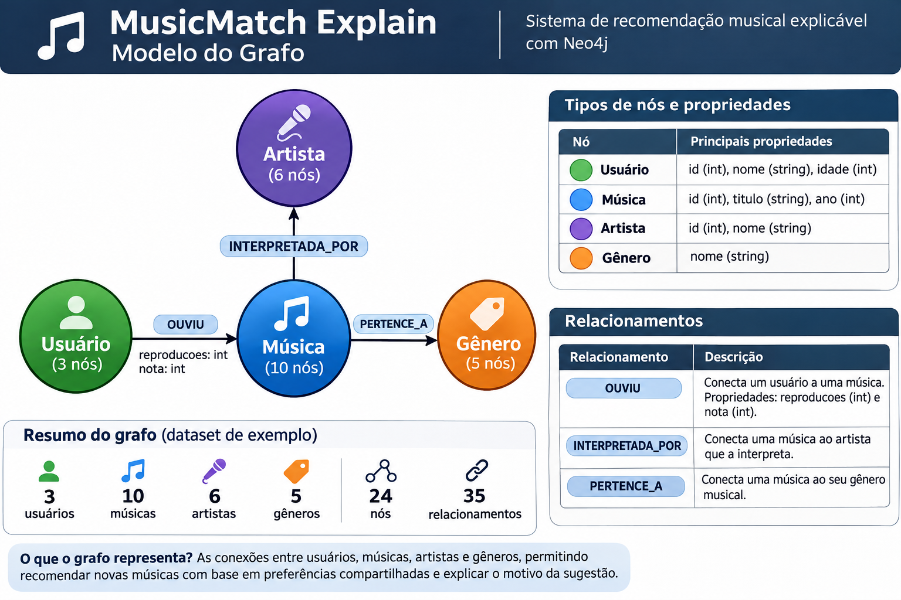

# 🎵 MusicMatch Explain
### Sistema de Recomendação Musical Explicável com Neo4j

## 1. Sobre o projeto

O **MusicMatch Explain** é uma prova de conceito de um sistema de recomendação musical desenvolvido com o banco de dados orientado a grafos Neo4j e a linguagem Cypher.

O projeto foi desenvolvido como parte de um desafio prático da DIO, com o objetivo de explorar a modelagem de grafos e sua aplicação em sistemas de recomendação.

O principal diferencial é a **explicabilidade das recomendações**: além de sugerir músicas, o algoritmo identifica quais usuários contribuíram para cada sugestão e quais preferências musicais possuem em comum.

## 2. Objetivos

- Modelar usuários, músicas, artistas e gêneros como um grafo.
- Representar históricos de reprodução por meio de relacionamentos.
- Identificar usuários com preferências semelhantes.
- Recomendar músicas ainda não ouvidas.
- Gerar justificativas para as recomendações.
- Executar consultas analíticas sobre o comportamento musical.

## 3. Tecnologias utilizadas

- **Neo4j Aura:** hospedagem do banco de dados em grafos.
- **Cypher:** linguagem utilizada para modelagem, consultas e recomendações.
- **Notepad++:** edição dos scripts.
- **GitHub:** versionamento e documentação.

## 4. Modelagem do grafo

O modelo utiliza quatro tipos de nós:

| Nó | Propriedades |
|---|---|
| Usuario | id, nome, idade |
| Musica | id, titulo, ano |
| Artista | id, nome |
| Genero | nome |

Foram definidos três tipos de relacionamentos:

| Relacionamento | Descrição |
|---|---|
| OUVIU | Conecta um usuário a uma música |
| INTERPRETADA_POR | Conecta uma música ao artista |
| PERTENCE_A | Conecta uma música ao gênero |

O relacionamento `OUVIU` possui propriedades adicionais: `reproducoes` e `nota`.

### Modelo inicial

O conjunto demonstrativo contém:

- 3 usuários
- 10 músicas
- 6 artistas
- 5 gêneros musicais
- 35 relacionamentos

Os dados utilizados nesta versão são fictícios e destinam-se à demonstração da lógica de recomendação.

### Diagrama do modelo de grafos

## 5. Como funciona o algoritmo?

O algoritmo utiliza filtragem colaborativa baseada em usuários.

Primeiro, identifica pessoas que ouviram músicas em comum com o usuário selecionado.

Depois, procura músicas ouvidas por essas pessoas que ainda não constam no histórico do usuário.

Cada usuário semelhante contribui com uma pontuação equivalente ao número de músicas compartilhadas.

**Pontuação da recomendação:**

Pontuação = soma das quantidades de músicas em comum com os usuários que ouviram a música candidata.

### Exemplo prático

Bruno e Ana possuem três músicas em comum:

- Bohemian Rhapsody
- We Will Rock You
- Yellow

Ana também ouviu *Tempo Perdido*, mas Bruno ainda não.

O algoritmo recomenda essa música para Bruno e informa que a sugestão foi motivada pela afinidade musical com Ana.

## 6. MusicMatch Explain — Recomendações explicáveis

O diferencial do projeto está na geração de justificativas baseadas nos caminhos percorridos no grafo.

Para cada recomendação, o sistema apresenta:

- Música recomendada
- Pontuação calculada
- Usuários que contribuíram para a sugestão
- Músicas compartilhadas entre os usuários

Assim, o resultado pode ser interpretado e verificado, em vez de apresentar somente uma lista de músicas.

## 7. Consultas analíticas

O projeto também contempla consultas para identificar:

- Músicas mais reproduzidas
- Artistas mais populares
- Gêneros mais ouvidos
- Usuários mais ativos
- Quantidade de nós e relacionamentos do grafo

Essas consultas demonstram a utilização do mesmo modelo tanto para recomendações quanto para análises descritivas.

## 8. Como executar o projeto

**Pré-requisito:** acesso a uma instância Neo4j Aura com permissão para executar consultas Cypher.

1. Acesse o Neo4j Aura e abra o editor Query.
2. Execute os comandos do arquivo `01_criar_modelo.cypher`.
3. Execute `02_inserir_dados.cypher`.
4. Execute `03_criar_relacionamentos.cypher`.
5. Execute `04_recomendacao_explicavel.cypher`.
6. Execute individualmente as consultas de `05_consultas_analiticas.cypher`.

Os arquivos estão organizados na pasta `scripts`.

Os scripts de criação e inserção devem ser executados na ordem apresentada. Caso o editor não permita executar vários comandos separados por ponto e vírgula de uma vez, execute cada bloco individualmente.

O projeto não exige uma aplicação web: o protótipo é executado diretamente no Neo4j.

## 9. SQL versus grafos

Em bancos relacionais, as associações entre registros normalmente são feitas por meio de chaves estrangeiras e operações `JOIN`.

No Neo4j, essas associações são representadas por relacionamentos explícitos entre nós.

Por exemplo, o caminho:

`Bruno → Yellow ← Ana → Tempo Perdido`

permite representar uma possível recomendação com base no histórico compartilhado entre os usuários.

Essa abordagem torna natural a expressão de consultas que exploram diferentes níveis de relacionamento.

Isso não significa que grafos sejam sempre superiores aos bancos relacionais. A escolha depende das características dos dados e dos padrões de consulta.

## 10. Limitações

Esta versão utiliza um conjunto de dados pequeno e fictício.

A similaridade é calculada pela quantidade de músicas compartilhadas, sem normalização pelo tamanho do histórico.

As avaliações e quantidades de reprodução estão armazenadas no banco, mas não participam diretamente da pontuação do algoritmo explicável.

Também não foi realizada uma avaliação estatística da qualidade das recomendações utilizando dados de treinamento e teste.

Portanto, o projeto demonstra o funcionamento técnico da abordagem, sem reivindicar precisão preditiva comprovada.

## 11. Possíveis evoluções

- Importar uma amostra de um dataset musical real.
- Comparar diferentes medidas de similaridade entre usuários.
- Incorporar avaliações e frequência de reprodução às recomendações.
- Comparar recomendações colaborativas e baseadas em gêneros.
- Avaliar a qualidade das sugestões com métricas apropriadas.
- Integrar o Neo4j a uma aplicação.

## 12. Ferramentas de Apoio ao Desenvolvimento

O projeto foi desenvolvido com o apoio do ChatGPT (OpenAI), utilizado como ferramenta de suporte ao aprendizado, à estruturação dos scripts Cypher, à implementação do algoritmo de recomendação e à elaboração da documentação.

Durante o desenvolvimento, executei as consultas, analisei os resultados e validei o funcionamento do projeto no Neo4j Aura.

Essa experiência também contribuiu para ampliar minha compreensão das diferenças entre bancos de dados relacionais (SQL) e bancos de dados orientados a grafos (Neo4j).

## 13. Considerações finais

O desenvolvimento do MusicMatch Explain permitiu aplicar conceitos de modelagem de grafos, consultas Cypher, agregações e algoritmos de recomendação.

A principal contribuição do projeto é demonstrar como os relacionamentos entre entidades podem ser utilizados não apenas para produzir recomendações, mas também para explicar a origem das sugestões.

O projeto foi desenvolvido para fins educacionais e como demonstração prática de conhecimentos em bancos de dados orientados a grafos.
